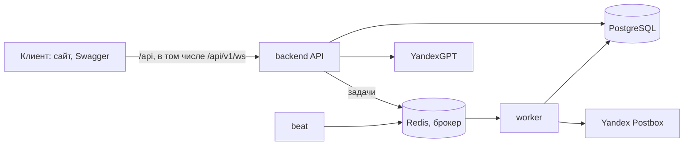
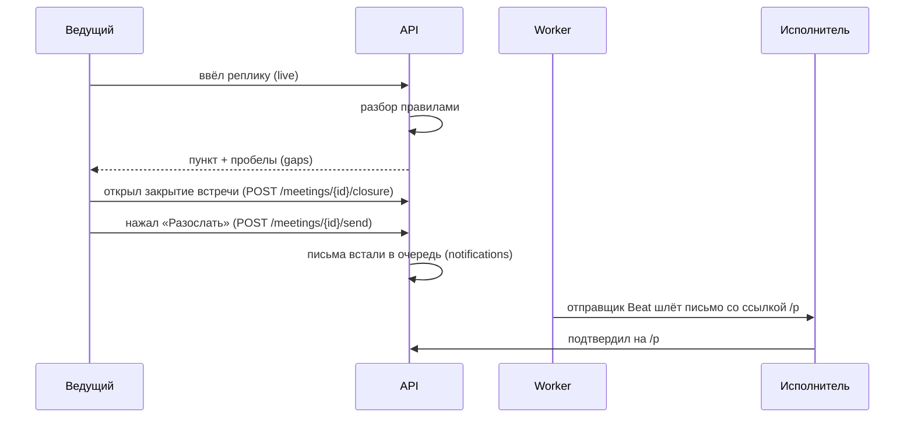
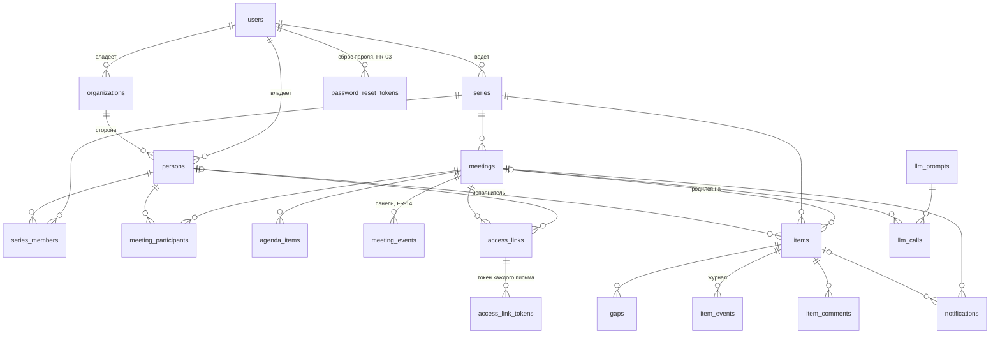

# Архитектура

Вся логика в одном backend-приложении (FastAPI) с модулями; фоновые задачи (письма, напоминания, чистка) идут через Celery. Клиент (сайт, Swagger, curl) ходит в API по HTTP и WebSocket. Фронтенд в этот репозиторий не входит.

## Модули `backend/app/modules/`
- `auth` вход, JWT в httpOnly-cookie.
- `series` серии регулярных встреч.
- `items` пункты: что, кто, срок, критерий, статус.
- `live` встреча в реальном времени (ввод пунктов, веб-сокет).
- `gaps` поиск пробелов в пункте (нет срока, нет ответственного).
- `llm` клиент OpenAI-совместимого API (`LLMClient`; YandexGPT, Groq), заглушка без ключа; промпт `parse` v3 (миграция `0013`), участники в модель как `p1..` с именем без фамилии, одна повторная попытка в пределах 8 с (у разбора до 4 с на попытку, на 429 повтора нет), выбор среди тёзок отбрасывается.
- `confirm` подтверждение пункта исполнителем по ссылке `/p`.
- `notifications` письма и напоминания: очередь, отправщик Beat (повторы, слияние, лимит), Postbox, без ключа только лог.
- `analytics` события продукта и выгрузка CSV.
- `demo` служебные ручки для показа в Swagger (нейросеть, ящик Mailpit, перемотка писем, события панели) и публичная страница нейросети с формой своей строки (`POST /demo/llm/try`); только при `DEV_MODE=1` и `DEMO_DATA=1`, вне контракта.
- `health` проба живости.

## Слои внутри модуля
`router.py` (HTTP: разбор запроса, коды ответа) → `service.py` (правила предметной области, транзакция) → `repository.py` (запросы SQLAlchemy). Роутер не ходит в базу, репозиторий не знает про HTTP. Так требует SRS. Рядом `schemas.py` (контракт API), `models.py` (таблицы), `tasks.py` (задачи Celery); если слою в модуле нечего делать, файла нет.

## Путь одного решения

Уточнение разбора через LLM (`enrich_item`) в этот путь пока не подключено. Страница исполнителя `/p/{token}` работает без входа: доступ по ссылке из письма, в базе только отпечаток токена.

Повторной рассылки нет: «Разослать» у встречи в `sent` возвращает прежний результат, а пункт, добавленный после рассылки, уходит сразу (`items.service.send_item`: статус pending, ссылка, CONFIRM_REQUEST, DUE_TOMORROW). Отправщик сливает письма одного типа одному получателю в пределах серии; лимит 3 в неделю считает слитые письма.

Пункт во всех ответах и кадрах WebSocket собирает `items.service.to_reads`: `assignee` = `{person_id, full_name, is_external}`, `load_warning` по BR-9, у пробела всегда заполнен `question`. Карточка добавляет `allowed_actions` (таблица переходов) и `last_response`.

## Модель данных
17 таблиц SRS v3, 3 служебные (`login_attempts`, `password_reset_tokens`, `access_link_tokens`) и журнал событий живой панели `meeting_events` (FR-14). Модели лежат в `app/modules/<модуль>/models.py`, реестр для Alembic — `app/models.py`.

- `items`: статус `draft → pending/accepted → done`, `disputed`, `cancelled`; просрочка вычисляется. `version` для `If-Match`.
- `access_links` / `access_link_tokens`: токены ссылки случайные, хранятся только SHA-256 (UNIQUE); у письма свой токен, все они действуют, пока жива ссылка (FR-30).

## Догрузка событий панели (FR-14)
- Каждое событие панели получает номер: `live.service.publish_after_commit` в транзакции изменения делает `UPDATE meetings SET events_version = events_version + 1 ... RETURNING` и пишет строку в `meeting_events`. Строка встречи заблокирована до commit, поэтому номера идут подряд в порядке commit.
- Кадр сервера несёт номер события в `version`, версия пункта лежит в `data.version` (`If-Match`). `GET /meetings/{id}` отдаёт `events_version` - с него клиент начинает.
- Клиент после каждого подключения шлёт `{"type": "resync", "since_version": n}` и получает события после `n` по порядку, затем живые кадры без повторов. Если `n` не целое, больше текущего или уже вычищено, приходит один кадр `resync.reset`: клиент перечитывает `GET /meetings/{id}`.
- Журнал чистит Beat через 30 дней после отправки итогов (или после `planned_end`). При обезличивании (FR-52) имя и email убираются и из `data` журнала.

## Режим разработки
Служебное (`/auth/token`, демо-данные, `app.demo`) включает только `DEV_MODE`, по умолчанию он выключен; подробности — в «Быстром старте» и «Развёртывании на сервере» корневого [README](../README.md).

## Запуск и проверки
- `compose.yaml`: db (PostgreSQL 16), redis, backend (миграции при старте, порт 8000), worker и beat (Celery). Подробно — README.
- На сервере перед API стоит обратный прокси (nginx): HTTPS и лимит 30 запросов в минуту с одного IP для `/p` (NFR-10). Его настройка в этот репозиторий не входит; лимиты входа (FR-02) держит само API.
